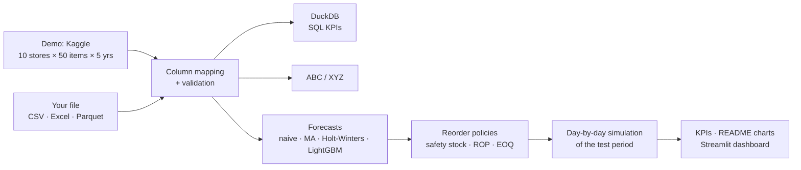

# 📦 Demand Forecasting & Inventory Optimization

**Forecast daily demand for every store and product, turn it into a reorder policy, and prove with a day-by-day
simulation that it needs less stock for the same service.** Works on the built-in demo (Kaggle, 10 stores × 50
products × 5 years) or on **your own sales history** (CSV / Excel upload).

**Live dashboard:** _deploy link — see [How to deploy](#8-deploy-the-dashboard-streamlit-community-cloud)_ ·
**Docs:** [`docs/`](docs/README.md) · **Notebooks:** [`notebooks/`](notebooks/)

---

## 1. The business problem

A distributor with **10 stores** and **50 products** has to decide **how much** and **when** to reorder.

- **Too much stock** → cash tied up in inventory, storage costs, obsolescence risk.
- **Too little stock** → stock-outs, lost sales, unhappy customers.

Today the rule is simple: *order about the same quantity every week*. This project forecasts demand and uses the
forecast to set a **reorder policy** that keeps a **95% service level with less inventory and lower cost**.

## 2. Key results

<!-- RESULTS:START -->
*Results appear here after the first full run on the Kaggle data (`python -m src.pipeline --all`).*
<!-- RESULTS:END -->

| | |
|---|---|
|  |  |
|  |  |

<details>
<summary><b>More charts</b> (demand, ABC/XYZ, one series day by day, sensitivity, channels)</summary>


</details>

## 3. How it works



| Phase | What | Where |
|---|---|---|
| 1. Explore | Trend, weekly and yearly seasonality; **ABC** by revenue, **XYZ** by weekly variability; 13 KPI queries in **SQL (DuckDB)** | [`01_eda_abc_xyz.ipynb`](notebooks/01_eda_abc_xyz.ipynb), [`sql/kpi_queries.sql`](sql/kpi_queries.sql) |
| 2. Forecast | Seasonal naive ("like last week"), 28-day moving average, **Holt-Winters**, one global **LightGBM**; rolling-origin back-test (a forecast every 7 days, 1–14 days ahead); **WAPE**, MAPE, bias | [`02_forecasting.ipynb`](notebooks/02_forecasting.ipynb), [`src/forecast.py`](src/forecast.py) |
| 3. Policy | Per store-item: safety stock `z·σ_L`, reorder point, **EOQ**; three policies: **P0** naive weekly order · **P1** static (s, Q) · **P2** forecast-driven (s, Q) | [`src/inventory.py`](src/inventory.py), [`src/policy.py`](src/policy.py) |
| 4. Simulate | Every day of the test period: deliveries arrive after the lead time, demand is served or lost, the policy decides the next order; fill rate, stock-outs, average stock, total cost | [`03_inventory_simulation.ipynb`](notebooks/03_inventory_simulation.ipynb), [`src/simulation.py`](src/simulation.py) |
| 5. Dashboard | Scenario (stores · products · online/physical), leaderboards, what-if on service level / lead time / costs, **upload of your own data** | [`app/`](app/streamlit_app.py) |

**Fair comparison.** A textbook `z = 1.645` gives a 95% *cycle* service level, which with large EOQ lots means a
fill rate close to 100% — policies would not be comparable. So each policy's knob is **calibrated per series** until
the simulated fill rate reaches 95%, and only then is the stock compared ([methodology](docs/08_methodology.md),
[ADR-0004](docs/adr/0004-lost-sales-and-iso-service-comparison.md)).

**No leakage.** Models are chosen on the validation year and scored on the test year; every forecast uses only
data up to its origin (checked by tests that change the future and verify the forecast does not move).

## 4. Use your own sales history

In the dashboard open **Data → My sales history**, upload a file, check the column mapping, run. Or from the terminal:

```bash
python -m src.pipeline --all --input my_sales.xlsx --map date=Data item=Articolo quantity=Qta store=Negozio
```

| Column | Required | If missing |
|---|---|---|
| `date`, `item`, `quantity` | ✅ | — |
| `store` | | all rows = one location |
| `unit_price`, `unit_cost` | | assumed prices (flagged "assumed" everywhere they are used) |
| `channel` (physical / online) | | physical |
| `lead_time_days` | | 7 days |

Any column names (mapped in the app, Italian and English names are recognised) · transaction-level rows are summed
per day · a day without rows = zero sales · at least 8 weeks of daily history; the train / validation / test split
and the features adapt to the length ([template](data/templates/sales_history_template.csv),
[full contract](docs/07_data_dictionary.md)). 🔒 Uploads stay in memory for the session and are never saved.

## 5. Scenario: stores · products · channel

The sidebar of every dashboard page selects **how many stores**, **which products** (top-N by revenue, random or
manual) and **which stores sell online** (80% of unmet online demand waits for the next delivery instead of being
lost; warehouse holding cost 20% instead of 25%). Every KPI updates instantly: results are computed once per
series for both channels and a scenario only filters and sums them ([ADR-0005](docs/adr/0005-configurable-scenario-and-channels.md)).

## 6. Assumptions (the demo has no cost data)

| Parameter | Value | Notes |
|---|---|---|
| Lead time `L` | 7 days | sensitivity at 3 and 14 days |
| Ordering cost `S` | €50 per order | per store-item order |
| Selling price `p` | €5–€50 per item | synthetic, fixed seed ([`item_prices.csv`](data/reference/item_prices.csv)) |
| Unit cost `c` | 60% of the price | |
| Holding cost | 25% of the unit cost per year | capital, space, obsolescence |
| Stock-out cost | lost margin `p − c` | physical stores: unmet demand is lost |
| Service target | 95% fill rate | policies are calibrated to it |

All in [`config/params.yaml`](config/params.yaml), and adjustable in the dashboard's what-if.

## 7. Run it locally

```bash
git clone <this repository> && cd supply-chain-inventory-optimization
python -m venv .venv && source .venv/bin/activate
pip install -r requirements-dev.txt && pip install -e .
python scripts/fix_lightgbm_macos.py      # macOS without Homebrew only (or: brew install libomp)
# put train.csv from Kaggle in data/raw/ (see data/README.md)
python -m src.pipeline --all              # about 2 minutes: SQL, back-tests, simulations, charts, artefacts
streamlit run app/streamlit_app.py
pytest                                    # 88 tests on synthetic data, under 10 seconds
```

Shortcuts: `make install` · `make demo` (pipeline + notebooks) · `make app` · `make test`.

## 8. Deploy the dashboard (Streamlit Community Cloud)

1. Push the repository to GitHub (the artefacts in `data/processed/artefacts/` are committed, ≈ 4 MB, the raw
   Kaggle file is not).
2. On [share.streamlit.io](https://share.streamlit.io) → *Create app* → pick the repository, branch `main`, main
   file `app/streamlit_app.py`, Python 3.12.
3. Copy the app URL into the top of this README.

The public app shows the demo from the committed artefacts (daily detail only for store 1, because of the Kaggle
licence) and runs uploads in fast mode (≤ 50 MB, ≤ 1,000 series).

## 9. Repository structure

```
supply-chain-inventory-optimization/
├── README.md                 ← you are here
├── config/params.yaml        ← every business assumption in one place
├── data/                     ← download instructions, upload template, demo artefacts (raw data git-ignored)
├── sql/kpi_queries.sql       ← 13 named KPI queries (DuckDB)
├── notebooks/                ← 01 EDA & ABC/XYZ · 02 forecasting · 03 inventory simulation
├── src/                      ← the Python package (ingest, forecast, inventory, simulation, KPIs, pipeline…)
├── app/                      ← Streamlit dashboard
├── reports/                  ← README charts and the data validation report
├── tests/                    ← pytest, synthetic data only
├── docs/                     ← charter, requirements, use cases, WBS, architecture, API, methodology, ADRs
└── scripts/                  ← macOS LightGBM helper
```

## 10. Tech stack

Python · pandas · NumPy · **DuckDB (SQL)** · statsmodels (Holt-Winters) · **LightGBM** · SciPy · matplotlib ·
Plotly · **Streamlit** · pytest + hypothesis · ruff · GitHub Actions

## 11. Limitations & next steps

- Costs, prices and lead times are assumptions (§6) unless the uploaded data provides them.
- Sales are treated as demand: real stock-outs in an uploaded history would hide some demand.
- The calibration uses the year it evaluates (an *oracle* setting, used only to compare policies on equal terms);
  the dashboard also shows the policies with `z` fixed in advance.
- Each store-item is independent: no shared supplier orders, capacity limits or transfers between stores.
- Next: quantile forecasts for the safety stock, periodic-review (R, S) policy, stochastic lead times, pooling of
  online stock, weekly / intermittent demand (Croston).

---

*Demo data: [Store Item Demand Forecasting Challenge](https://www.kaggle.com/competitions/demand-forecasting-kernels-only)
(Kaggle; not redistributed here — download it yourself, see [`data/README.md`](data/README.md)).*
