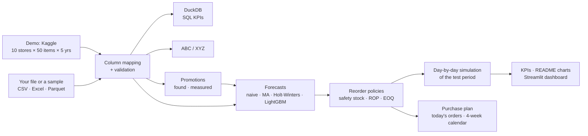

<p align="center"></p>

# Demand Forecasting & Inventory Optimization

**Forecast daily demand for every store and product, turn the forecast into a reorder policy, and prove with a
day-by-day simulation that it needs less stock for the same service level.**

It works on the built-in demo (Kaggle: 10 stores × 50 products × 5 years of daily sales), on invented sample data
of a fictional Italian retailer, or on **your own sales history** (CSV / Excel upload, any column names).

**Live dashboard:** _link after deployment — see [§10](#10-deploy-the-dashboard-online)_ ·
**Docs:** [`docs/`](docs/README.md) · **Notebooks:** [`notebooks/`](notebooks/) ·
**Run it on your computer:** [step-by-step guide for Windows and macOS](#13-step-by-step-run-it-on-your-computer)

---

## Contents

1. [The business problem](#1-the-business-problem)
2. [Key results](#2-key-results)
3. [How it works](#3-how-it-works)
4. [The dashboard](#4-the-dashboard)
5. [Use your own sales history](#5-use-your-own-sales-history)
6. [Sample data (no download needed)](#6-sample-data-no-download-needed)
7. [Assumptions](#7-assumptions)
8. [Command line](#8-command-line)
9. [Repository structure](#9-repository-structure)
10. [Deploy the dashboard online](#10-deploy-the-dashboard-online)
11. [Tech stack and quality](#11-tech-stack-and-quality)
12. [Limitations and next steps](#12-limitations-and-next-steps)
13. [Step by step: run it on your computer (Windows · macOS)](#13-step-by-step-run-it-on-your-computer)

---

## 1. The business problem

A distributor with **10 stores** and **50 products** has to decide **how much** and **when** to reorder.

- **Too much stock** → cash tied up in inventory, storage costs, products that expire or go out of fashion.
- **Too little stock** → empty shelves, lost sales, unhappy customers.

Today the rule is simple: *order about the same quantity every week*. This project forecasts demand and uses the
forecast to set a **reorder policy** that keeps a **95% service level with less inventory and lower cost**.

## 2. Key results

<!-- RESULTS:START -->
*Results appear here after the first full run on the Kaggle data (`python -m src.pipeline --all`).*
<!-- RESULTS:END -->

The block above is written by the pipeline itself from the same results the dashboard shows, so the numbers in
this README can never drift from the analysis.

| | |
|---|---|
|  |  |
|  |  |

<details>
<summary><b>More charts</b> (demand, ABC/XYZ, one series day by day, sensitivity, channels)</summary>


</details>

**On the sample retail data** (invented, see [§6](#6-sample-data-no-download-needed)): LightGBM makes 27% less
forecast error than "like last week", and at the same 95% fill rate the forecast-driven policy holds 19% less stock
than the weekly order and 9% less than a classic static policy. On a Christmas-only product it keeps 41 units on
the shelf out of season instead of 92, and serves 96% of the Christmas demand instead of 85%.

## 3. How it works



| Phase | What | Where |
|---|---|---|
| 1. Explore | Trend, weekly and yearly seasonality; **ABC** by revenue, **XYZ** by weekly variability; 13 KPI queries in **SQL (DuckDB)** | [`01_eda_abc_xyz.ipynb`](notebooks/01_eda_abc_xyz.ipynb), [`sql/kpi_queries.sql`](sql/kpi_queries.sql) |
| 2. Forecast | Seasonal naive ("like last week"), 28-day moving average, **Holt-Winters**, one global **LightGBM**; rolling-origin back-test (a forecast every 7 days, 1–14 days ahead); **WAPE**, MAPE, bias | [`02_forecasting.ipynb`](notebooks/02_forecasting.ipynb), [`src/forecast.py`](src/forecast.py) |
| 2b. Promotions | Found from a promo column or from discounted prices; effect per product (extra sales during, dip after); the forecasts use the promotion calendar; a **planner** for future promotions | [`src/promotions.py`](src/promotions.py) |
| 3. Policy | Per store-item: safety stock `z·σ_L`, reorder point, **EOQ** lot (capped at 28 days of demand); three policies: **P0** same order every Monday · **P1** static (s, Q) · **P2** forecast-driven (s, Q) | [`src/inventory.py`](src/inventory.py), [`src/policy.py`](src/policy.py) |
| 4. Simulate | Every day of the test period: deliveries arrive after the lead time, demand is served or lost, the policy decides the next order; fill rate, stock-outs, average stock, total cost | [`03_inventory_simulation.ipynb`](notebooks/03_inventory_simulation.ipynb), [`src/simulation.py`](src/simulation.py) |
| 4b. Order | The chosen policy on today's calendar: forward forecast, current stock (estimated or uploaded), **today's orders by supplier** and a 4-week calendar of orders and deliveries | [`src/replenishment.py`](src/replenishment.py) |
| 5. Dashboard | Scenario (stores · products · online/physical), leaderboards, what-if, upload of your own data | [`app/`](app/streamlit_app.py) |

**Fair comparison.** A textbook `z = 1.645` gives a 95% *cycle* service level, which with large lots means a fill
rate close to 100%: policies would not be comparable. So each policy's knob is **calibrated per series** until the
simulated fill rate reaches 95%, and only then is the stock compared ([methodology](docs/08_methodology.md),
[ADR-0004](docs/adr/0004-lost-sales-and-iso-service-comparison.md)).

**No leakage.** Models are chosen on the validation period and scored on the test period; every forecast uses only
data up to the day it is made (tests change the future and check that the forecast does not move).

**Adapts to the data.** The train / validation / test split, the features (yearly seasonality only with enough
history) and the models are chosen from the length of the history, so the same code runs on 8 weeks or 5 years.

## 4. The dashboard

| Page | What you see |
|---|---|
| **Overview** | The headline in one sentence, KPI tiles, inventory and cost of the three policies at the same fill rate, breakdown by ABC class and by channel |
| **Demand** | Monthly trend, weekday and month indices, ABC Pareto curve, ABC × XYZ matrix, the SQL behind the KPIs |
| **Forecast** | Model leaderboard, error by horizon / class / store, actual vs. forecast for one series, what LightGBM relies on |
| **Promotions** | How much each product sells more on promotion and less the week after, past promotions on a chart, forecast error on promotion days, a **planner** (item, dates, discount → extra units to order, order-by date, margin) and a price-change estimate |
| **Inventory** | Inventory vs. fill rate curves, reorder point and lot for one series, its stock day by day, a **what-if** (service level, lead time, ordering and holding cost), sensitivity |
| **Orders** | **What to order today**, grouped by supplier (quantity, value, arrival date, CSV per supplier); a **4-week calendar** of orders and deliveries; expected stock-outs; stock day by day for one item. **Supplier terms and limits**: order and delivery days, minimum order value, pack sizes, minimum quantities, quantity discounts, weekly budget, warehouse space — with what they cost compared with no constraints. Works on today's date: old data are moved forward by whole weeks |
| **FAQ** · **Privacy** · **Terms** | Frequently asked questions, privacy policy (what happens to your files, anonymous usage statistics with opt-out) and terms of use; Privacy and Terms are linked in the sidebar footer |
| **Data** | Switch between the demo, a sample dataset and your own file; column mapping, data checks, one-click analysis, downloads (reorder plan CSV, results Excel) |

The **sidebar** on every page selects the scenario: **how many stores**, **which products** (top-N by revenue,
random or manual) and **which stores sell online** (online, 80% of unmet demand waits for the next delivery instead
of being lost, and warehouse holding costs less). Every number updates instantly
([ADR-0005](docs/adr/0005-configurable-scenario-and-channels.md)).

## 5. Use your own sales history

In the dashboard: **Data → My sales history → Upload a file**, check the column mapping, press **Run analysis**.

| Column | Required | If missing |
|---|---|---|
| `date`, `item`, `quantity` | ✅ | — |
| `store` | | all rows = one location |
| `unit_price`, `unit_cost` | | assumed prices (flagged "assumed" everywhere they are used) |
| `channel` (physical / online) | | physical |
| `lead_time_days` | | 7 days |
| `promo` (yes/no or discount, e.g. `20%`) | | found from the prices (a day ≥ 8% below the usual price); none without prices |
| `supplier`, `item_name` | | orders grouped under "supplier not set" |
| `pack_size`, `min_order_qty` | | orders in single units, no minimum |

- Column names can be anything: English and Italian names are recognised (`Data`, `Articolo`, `Qtà`, `Negozio`…).
- CSV (any separator, decimal commas), Excel (sheet picker) and Parquet; one row per day or per transaction
  (rows are summed per day); a day without rows counts as zero sales; returns (negative quantities) are set to zero.
- At least 8 weeks of daily history. Prices, costs and lead times can come from a separate item-master file.
- **Promotions**: with a `promo` column or a daily price, the software finds the promotion days, measures their
  effect per product and uses them in the forecasts. Planned promotions (e.g. next month's flyer) can be typed in
  or loaded on the **Promotions** page — example: [`data/samples/promo_calendar_2025.csv`](data/samples/promo_calendar_2025.csv).
- **Orders**: the order list uses your current stock if you upload it (`store, item, stock on hand[, on order,
  arrival date]`, e.g. [`data/samples/stock_snapshot.csv`](data/samples/stock_snapshot.csv)); otherwise the software
  estimates it. For a real list, upload sales up to yesterday and today's stock. Supplier terms (order days, minimum
  order, discounts) can be typed in or loaded, e.g. [`data/samples/supplier_terms.csv`](data/samples/supplier_terms.csv).
- 🔒 Uploads stay in memory for your session only and are never saved. For confidential data run the app locally.
- Template: [`data/templates/sales_history_template.csv`](data/templates/sales_history_template.csv) ·
  full contract: [`docs/07_data_dictionary.md`](docs/07_data_dictionary.md).

## 6. Sample data (no download needed)

[`data/samples/`](data/samples/README.md) contains **invented but realistic** sales data of a fictional Italian
retailer, to try every feature without your own data (in the dashboard: **Data → My sales history → Use a sample
dataset**):

| File | Content |
|---|---|
| `retail_chain_sales.csv` + `retail_chain_items.csv` | 8 stores (one online) × 32 products × 3 years, with item master (prices, costs, lead times) |
| `single_store_it.csv` | a neighbourhood shop exported "the Italian way": `;`, dates `dd/mm/yyyy`, decimal commas |
| `ecommerce_order_lines.xlsx` | one year of online order lines with timestamps and returns |

Hidden inside: Christmas and Easter products, promotions with discounted prices, Italian holidays and August
closures, a store opening mid-way, a renovation, a product launch, a discontinued product, intermittent and lumpy
demand. The promotions are not marked in the file: the software finds them from the discounted prices, and using
them cuts LightGBM's error from 36.9% to 34.1%. Rebuild the data identically with `python -m src.sample_data`. No real company or sales figure is represented.

## 7. Assumptions

The Kaggle demo has no prices, costs or lead times; these values are used whenever the data does not provide them:

| Parameter | Value | Notes |
|---|---|---|
| Lead time `L` | 7 days | sensitivity at 3 and 14 days |
| Ordering cost `S` | €50 per order | per store-item order |
| Selling price `p` | €5–€50 per item | synthetic, fixed seed (Kaggle demo only) |
| Unit cost `c` | 60% of the price | |
| Holding cost | 25% of the unit cost per year | capital, space, obsolescence |
| Lot size | EOQ, capped at 28 days of demand | shelf space and freshness |
| Stock-out cost | lost margin `p − c` | physical stores: unmet demand is lost |
| Service target | 95% fill rate | every policy is calibrated to it |

All in [`config/params.yaml`](config/params.yaml); the dashboard's what-if and the *Cost assumptions* box on the
Data page change them without editing files.

## 8. Command line

With the environment active (see [§13](#13-step-by-step-run-it-on-your-computer)):

```bash
python -m src.pipeline --all                                   # Kaggle demo (data/raw/train.csv): charts, artefacts, README results
python -m src.pipeline --all --input data/samples/retail_chain_sales.csv --item-master data/samples/retail_chain_items.csv
python -m src.pipeline --all --input my_sales.xlsx --map date=Data item=Articolo quantity=Qta store=Negozio
python -m src.sample_data                                      # rebuild the sample datasets
python -m src.partition --input big_sales.csv --workers 2      # large files, in batches (see below)
streamlit run app/streamlit_app.py                             # dashboard
pytest                                                         # 126 tests, about a minute
```

**Large datasets.** The dashboard keeps every series in memory: it handles up to 10,000 store-item series in about
a minute. Above that, the **batch mode** reads the file with DuckDB without loading it, splits the items into groups
of about 20,000 series (every store of an item in the same group, so ABC / XYZ stay exact), analyses one group at a
time (or `--workers` in parallel) and writes Parquet tables, the totals (`results.json`) and
`reorder_parameters.csv` (lot, safety stock and reorder point per store and item, for an ERP import).

| Measured on a 10-core laptop, 16 GB, fast mode, 2 years of daily sales | Series | Time | Memory |
|---|---|---|---|
| Dashboard / single run | 10,000 | 1 min | 3.5 GB |
| Single run | 30,000 | 2 min | 5.5 GB |
| Batch mode, 2 workers | 60,000 | 4.5 min | 6 GB |
| Batch mode, 2 workers (estimate, linear) | 2,000,000 (20,000 items × 100 stores) | ≈ 2.5 h | ≈ 6 GB |

On macOS / Linux the same steps have shortcuts: `make install` · `make app` · `make demo` · `make sample-data` ·
`make test`.

## 9. Repository structure

```
supply-chain-inventory-optimization/
├── README.md                 ← you are here
├── config/params.yaml        ← every business assumption in one place
├── data/
│   ├── raw/                  ← put the Kaggle train.csv here (not in git)
│   ├── samples/              ← invented sample datasets + their story
│   ├── templates/            ← upload template
│   └── processed/            ← database and dashboard results (created by the pipeline)
├── sql/kpi_queries.sql       ← 13 named KPI queries (DuckDB)
├── notebooks/                ← 01 EDA & ABC/XYZ · 02 forecasting · 03 inventory simulation
├── src/                      ← the Python package (ingest, forecast, inventory, simulation, KPIs, pipeline…)
├── app/                      ← Streamlit dashboard
├── reports/                  ← README charts and the data validation report
├── tests/                    ← pytest, synthetic data only
├── docs/                     ← charter, requirements, use cases, WBS, architecture, API, methodology, ADRs
├── scripts/                  ← macOS LightGBM helper
└── Makefile                  ← shortcuts for macOS / Linux
```

## 10. Deploy the dashboard online

1. Push the repository to GitHub (the dashboard results in `data/processed/artefacts/` are committed, about 4 MB;
   the raw Kaggle file is not).
2. On [share.streamlit.io](https://share.streamlit.io) → *Create app* → choose the repository, branch `main`,
   main file `app/streamlit_app.py`, Python 3.12.
3. Copy the app address to the top of this README.
4. Before sharing it, follow the [publishing checklist](docs/12_deployment.md): owner and contact for the privacy
   policy (`site` in `config/params.yaml`), `python -m src.site_files --base-url <address>` for robots.txt and
   sitemap.xml, upload limits for the host's memory, usage statistics (`python -m src.analytics` for the report).

The public app shows the demo from the committed results (daily detail only for store 1, because of the Kaggle
licence) and runs uploads and sample datasets in fast mode. The upload limits in `config/params.yaml`
(`input.limits`: 300 MB, 10M rows, 10,000 series) are sized for a laptop; for a free online host (about 1 GB of
memory) set them to about 50 MB and 1,000 series, and `maxUploadSize` in `.streamlit/config.toml` to match.

## 11. Tech stack and quality

Python · pandas · NumPy · **DuckDB (SQL)** · statsmodels (Holt-Winters) · **LightGBM** · SciPy · matplotlib ·
Plotly · **Streamlit** · pytest + hypothesis · ruff · GitHub Actions.

96 automated tests (formulas, simulation invariants, no-leakage checks, SQL vs. pandas, messy input files, the
whole pipeline) run on every push. Design documents: charter, requirements, use cases, WBS, architecture, API,
methodology, KPI definitions, test plan, risks and decision records in [`docs/`](docs/README.md).

## 12. Limitations and next steps

The dashboard shows the same list, with the warnings on the data in use, in the **Warnings and limits** panel of the
sidebar.

- Size: the dashboard handles up to 10,000 store-item series (≈ 1 minute); larger files run in batch mode
  (`python -m src.partition`, ≈ 2.5 h for 2 million series on a laptop) and their results are Parquet / CSV files,
  not dashboard pages.
- Forecasts use no outside factors (weather, local events, competitors); new and rarely sold items are forecast
  poorly.
- Uploaded data and results live only in the browser session; one user, no login.
- As a website: titles and descriptions are written into the page by a script, a missing page shows a 404 page with
  HTTP status 200, `robots.txt` / `sitemap.xml` reach the root only through a reverse proxy
  ([publishing guide](docs/12_deployment.md)); privacy policy and terms are templates to review.
- Euro results are estimates: the cost of an order and the holding rate never come from the sales file (they are the
  assumptions of §7 or the values typed on the Data page), and missing prices, unit costs and lead times are assumed.
  The **Warnings and limits** panel lists the values used and how much the saving moves if the order and holding
  costs are between half and 1.5 times them.
- Sales are treated as demand: real stock-outs in an uploaded history would hide some demand.
- The calibration uses the period it evaluates (an *oracle* setting, used only to compare policies on equal terms);
  the dashboard also shows the policies with `z` set in advance.
- Each store-item is planned on its own: no transfers between stores, no central warehouse. Supplier terms and
  warehouse space apply to the order plan (Orders page), not to the policy comparison on the past.
- Promotions: one effect per product for all stores; no cannibalisation between products; the price-change estimate
  is derived from promotions and only indicative.
- Orders: the plan proposes orders, it does not send them (no link to an ERP or to suppliers); one discount
  threshold per supplier; warehouse space in units, not volume; without uploaded stock the stock is an estimate.
- Next: quantile forecasts for the safety stock, periodic-review (R, S) policy, stochastic lead times, pooling of
  online stock, weekly / intermittent demand models (Croston).

---

## 13. Step by step: run it on your computer

A simple guide that assumes nothing. It takes about 10 minutes the first time; afterwards starting the dashboard
takes two commands. Pick your system:

- [Windows](#windows)
- [macOS](#macos)

### What you get at the end

The dashboard runs in your browser at **http://localhost:8501**. It runs only on your computer: nothing is sent
online.

---

### Windows

**1. Install Python (once)**

1. Go to [python.org/downloads](https://www.python.org/downloads/) and download **Python 3.12** or **3.13**
   ("Windows installer 64-bit").
2. Run the installer and, on the first screen, **tick "Add python.exe to PATH"**. Then click *Install Now*.
3. Check it worked: open the **Start menu**, type `PowerShell`, open *Windows PowerShell* and type:
   ```powershell
   py --version
   ```
   You should see `Python 3.12.x` (or 3.13).

**2. Get the project folder**

- If you have the folder (e.g. a zip): unzip it, for example into `Documents\supply-chain-inventory-optimization`.
  Do **not** copy a `.venv` folder made on another computer: delete it if present.
- If it is on GitHub: install [Git for Windows](https://git-scm.com/download/win), then in PowerShell
  `git clone <repository address>`.

**3. Open PowerShell in the project folder**

Open the folder in File Explorer, click the address bar, type `powershell` and press Enter. A PowerShell window
opens already inside the folder. (Or type `cd` followed by the folder path, e.g.
`cd $HOME\Documents\supply-chain-inventory-optimization`.)

**4. Create the environment and install everything (once, 3–5 minutes)**

Copy these commands one at a time:

```powershell
py -m venv .venv
.venv\Scripts\python -m pip install --upgrade pip
.venv\Scripts\python -m pip install -r requirements-dev.txt
.venv\Scripts\python -m pip install -e .
```

The `.venv` folder is a private copy of Python for this project: nothing else on your computer changes.

**5. (Optional) Create the sample data**

If the folder `data\samples` is missing or empty:

```powershell
.venv\Scripts\python -m src.sample_data
```

**6. Start the dashboard**

```powershell
.venv\Scripts\python -m streamlit run app\streamlit_app.py
```

When the window shows `Local URL: http://localhost:8501`, open your browser (Edge, Chrome…) at
**http://localhost:8501**. The first time, Windows may ask whether to allow network access for Python: **Allow**
(it is only for your own computer). Leave the PowerShell window open while you use the dashboard.

**7. Try it**

Go to **Data → My sales history → Use a sample dataset**, choose *Retail chain*, scroll down and press
**Run analysis**. After about 10 seconds every page shows the results.

**8. Stop it**

Go back to the PowerShell window and press **Ctrl + C**. Next time, only steps 3 and 6 are needed.

**9. (Optional) The Kaggle demo**

Download `train.csv` as explained in [`data/README.md`](data/README.md), put it in `data\raw\`, then run
`.venv\Scripts\python -m src.pipeline --all` (about 2–3 minutes) and restart the dashboard (step 6).

**If something goes wrong on Windows**

| Message | What to do |
|---|---|
| `py` / `python` is not recognized | Python is not installed or not on PATH: reinstall it ticking *Add python.exe to PATH*, then open a new PowerShell |
| `running scripts is disabled on this system` | You tried `.venv\Scripts\activate`: not needed with the commands above. If you want it, run once `Set-ExecutionPolicy -Scope CurrentUser RemoteSigned` |
| `No matching distribution found` during install | Your Python is too old or too new: install Python 3.12 and repeat step 4 after deleting the `.venv` folder |
| `Port 8501 is already in use` | The dashboard is already running in another window: use that one, or close it with Ctrl + C |
| Microsoft Visual C++ error when importing LightGBM | Install the [Microsoft Visual C++ Redistributable](https://learn.microsoft.com/cpp/windows/latest-supported-vc-redist) (x64) and try again |

---

### macOS

**1. Install Python (once)**

1. Go to [python.org/downloads](https://www.python.org/downloads/) and download the latest **macOS 64-bit
   universal2 installer** (Python 3.12 or newer), then open it and follow the steps.
2. Open the **Terminal** app (press `Cmd + Space`, type `Terminal`, press Enter) and check:
   ```bash
   python3 --version
   ```
   On macOS the command is **`python3`**, not `python`.
3. The first time you use developer tools macOS may propose to install the *Command Line Tools*: accept, it takes a
   few minutes (it gives you `make` and `git`).

**2. Get the project folder**

Put the folder somewhere easy, e.g. `Desktop`. If it comes from GitHub: `git clone <repository address>`.

**3. Open Terminal in the project folder**

Type `cd ` (with a space), drag the project folder from Finder into the Terminal window, press Enter. Check with
`ls`: you should see `README.md`, `app`, `src`…

**4. Install everything (once, 3–5 minutes)**

```bash
make install
```

This creates the private environment `.venv`, installs the libraries and, on Macs without Homebrew, fixes LightGBM
automatically. (Without `make`: `python3 -m venv .venv`, then `.venv/bin/pip install -r requirements-dev.txt`,
`.venv/bin/pip install -e .` and `.venv/bin/python scripts/fix_lightgbm_macos.py`.)

**5. (Optional) Create the sample data**

If the folder `data/samples` is missing or empty:

```bash
make sample-data
```

**6. Start the dashboard**

```bash
make app
```

When Terminal shows `Local URL: http://localhost:8501`, open your browser (Safari, Chrome…) at
**http://localhost:8501**. Leave the Terminal window open while you use the dashboard.

**7. Try it**

Go to **Data → My sales history → Use a sample dataset**, choose *Retail chain*, scroll down and press
**Run analysis**. After about 10 seconds every page shows the results.

**8. Stop it**

In Terminal press **Ctrl + C**. Next time, only steps 3 and 6 are needed.

**9. (Optional) The Kaggle demo**

Download `train.csv` as explained in [`data/README.md`](data/README.md), put it in `data/raw/`, then run
`make demo` (about 2–3 minutes: results, charts, notebooks) and restart the dashboard (`make app`).

**If something goes wrong on macOS**

| Message | What to do |
|---|---|
| `command not found: python` / `pip` | Use `python3`, or use the commands above that start with `make` or `.venv/bin/…` |
| `command not found: streamlit` | The environment is not active: use `make app` (or `.venv/bin/streamlit run app/streamlit_app.py`) |
| `command not found: make` | Run `xcode-select --install`, accept, then retry |
| `Library not loaded: @rpath/libomp.dylib` | Run `.venv/bin/python scripts/fix_lightgbm_macos.py` (or `brew install libomp` if you use Homebrew) |
| `Port 8501 is already in use` | The dashboard is already running in another Terminal window: use that one, or stop it with Ctrl + C |

---

*Demo data: [Store Item Demand Forecasting Challenge](https://www.kaggle.com/competitions/demand-forecasting-kernels-only)
(Kaggle; not redistributed here — download it yourself, see [`data/README.md`](data/README.md)).*
