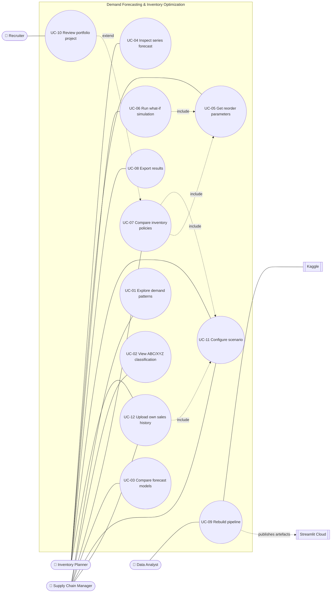

# 03 — Use Cases

## 1. Actors

| Actor | Type | Description |
|---|---|---|
| **Inventory Planner** | Primary, human | Decides order quantities and reorder points; uses the dashboard every day. |
| **Supply Chain Manager** | Primary, human | Sets the service target and the budget; compares policies and costs. |
| **Data Analyst** (project owner) | Primary, human | Runs the pipeline, trains models, keeps the code and data up to date. |
| **Recruiter / Hiring Manager** | Primary, human | Reads the README and opens the dashboard to judge the project. |
| **Kaggle** | Secondary, external system | Source of the raw dataset. |
| **Streamlit Community Cloud** | Secondary, external system | Hosts the dashboard; rebuilds it on every git push. |

## 2. Use case diagram

> Mermaid has no native UML use-case notation; ellipses = use cases, rounded boxes = actors, double boxes = external systems. Dotted arrows show «include» / «extend».

## 3. Use case summary

| ID | Name | Primary actor | Priority | Dashboard page / artefact |
|---|---|---|---|---|
| UC-01 | Explore demand patterns | Supply Chain Manager | M | Demand |
| UC-02 | View ABC/XYZ classification | Supply Chain Manager | M | Demand |
| UC-03 | Compare forecast models | Supply Chain Manager | M | Forecast |
| UC-04 | Inspect series forecast | Inventory Planner | M | Forecast |
| UC-05 | Get reorder parameters for a series | Inventory Planner | M | Inventory |
| UC-06 | Run what-if simulation | Inventory Planner | S | Inventory → What-if |
| UC-07 | Compare inventory policies | Supply Chain Manager | M | Overview |
| UC-08 | Export results | Inventory Planner | S | Any page |
| UC-09 | Rebuild pipeline end-to-end | Data Analyst | M | CLI |
| UC-10 | Review portfolio project | Recruiter | M | README + Overview |
| UC-11 | Configure scenario (stores, products, channel) | Supply Chain Manager, Inventory Planner | M | Sidebar (all pages) |
| UC-12 | Upload own sales history | Inventory Planner, Supply Chain Manager | M | Data page |

## 4. Detailed specifications

### UC-01 — Explore demand patterns
| | |
|---|---|
| **Goal** | Understand trend and seasonality to trust the forecasts. |
| **Pre-conditions** | Artefacts built (UC-09). |
| **Main flow** | 1. User opens *Demand*. 2. System shows total daily sales with a 28-day moving average and the YoY trend. 3. System shows the day-of-week index and the monthly index. 4. User filters by store and/or item. 5. System redraws the charts for the filter. |
| **Alternative flows** | 4a. User picks "All" → aggregated view. |
| **Post-conditions** | None (read-only). |
| **Requirements** | FR-05, FR-29 |

### UC-02 — View ABC/XYZ classification
| | |
|---|---|
| **Goal** | See which items matter most (A) and which are hardest to forecast (Z). |
| **Main flow** | 1. User opens *Demand → Classification*. 2. System shows the Pareto curve of revenue by item with A/B/C cut-offs. 3. System shows the 3×3 ABC×XYZ matrix (count of items, % of revenue). 4. User clicks a cell → list of items in that cell. |
| **Business rule** | Classes use revenue and weekly CV of the reference period (the validation period just before the test period; 2016 in the demo). |
| **Requirements** | FR-06 – FR-08, FR-29 |

### UC-03 — Compare forecast models
| | |
|---|---|
| **Goal** | Pick the model with the lowest error and no bias. |
| **Main flow** | 1. User opens *Forecast*. 2. System shows the leaderboard (WAPE, MAPE, bias, RMSE) for the test-period back-test. 3. System shows the headline "best model cuts WAPE by X% vs. seasonal naive". 4. User switches the breakdown: by ABC class / by horizon / by store. |
| **Requirements** | FR-13 – FR-15, FR-30 |

### UC-04 — Inspect series forecast
| | |
|---|---|
| **Goal** | Check forecast quality for one store-item. |
| **Main flow** | 1. User selects store, item and model(s). 2. System plots actual vs. forecast for the test period and the error metrics of that series. |
| **Alternative flows** | 2a. Several models selected → overlaid lines. |
| **Requirements** | FR-30 |

### UC-05 — Get reorder parameters for a series
| | |
|---|---|
| **Goal** | Know *when* (ROP) and *how much* (Q) to order. |
| **Main flow** | 1. User selects store and item. 2. System shows mean daily demand, σ over the lead time, safety stock, ROP, EOQ, expected orders per year and expected annual cost. 3. System shows the formulas used with the numbers filled in. |
| **Requirements** | FR-17, FR-31 |

### UC-06 — Run what-if simulation
| | |
|---|---|
| **Goal** | See how a change in assumptions changes cost and service. |
| **Pre-conditions** | A series is selected (UC-05). |
| **Main flow** | 1. User moves sliders: service level (80–99.9%), lead time (1–21 d), ordering cost (€5–€500), holding rate (5–50%). 2. System recomputes SS/ROP/EOQ (**include UC-05**). 3. System re-simulates 2017 for that series in under 1 s. 4. System shows the new KPIs next to the baseline and the inventory chart. |
| **Exceptions** | E1. Invalid input (e.g. service level = 100%) → the slider range stops it; the API raises `ValueError`. |
| **Requirements** | FR-21, FR-32, NFR-02 |

### UC-07 — Compare inventory policies
| | |
|---|---|
| **Goal** | Show the business value of the optimised policy. |
| **Main flow** | 1. User opens *Overview* (for the active scenario, **include UC-11**). 2. System shows KPI cards for P0/P1/P2: fill rate, average inventory (€), stock-out days, total cost. 3. System shows the headline "−X% average inventory at a 95% fill rate". 4. System shows the scatter of average inventory vs. fill rate per policy and a breakdown by ABC class. |
| **Requirements** | FR-19, FR-20, FR-25, FR-28 |

### UC-08 — Export results
| | |
|---|---|
| **Main flow** | 1. User clicks "Download CSV" on any table. 2. System downloads the filtered table. |
| **Requirements** | FR-33 |

### UC-09 — Rebuild pipeline end-to-end
| | |
|---|---|
| **Goal** | Reproduce every number from the raw data — the demo or a user file (`--input`, see UC-12). |
| **Pre-conditions** | `train.csv` in `data/raw/` (see `data/README.md`); dependencies installed. |
| **Main flow** | 1. Analyst runs `python -m src.pipeline --all`. 2. System validates the data → builds DuckDB → runs the SQL KPIs → classification → back-test → policy parameters → simulation → KPIs → figures → artefacts. 3. System logs the duration of each step and writes `data/processed/artefacts/manifest.json`. |
| **Alternative flows** | 1a. `--step forecast` runs one step only (it needs the earlier step's outputs). |
| **Exceptions** | E1. Raw file missing → clear error message with the download command. E2. Validation fails → stop with a report in `reports/validation.md`. |
| **Post-conditions** | Artefacts and figures updated; git shows the changes. |
| **Requirements** | FR-01 – FR-04, FR-26, FR-27, NFR-01 |

### UC-10 — Review portfolio project
| | |
|---|---|
| **Goal** | The recruiter understands the business impact in under 2 minutes. |
| **Main flow** | 1. Recruiter opens the GitHub repo. 2. Reads the problem + key results table (numbers first). 3. Looks at the charts. 4. Optionally clicks the live dashboard link → *Overview* (**extends UC-07**). |
| **Success guarantee** | The headline sentence with real numbers can be seen without scrolling past the first screen. |
| **Requirements** | NFR-08 |

### UC-11 — Configure scenario
| | |
|---|---|
| **Goal** | Analyse a business that matches the user's case: how many stores, how many products, which stores sell online. |
| **Pre-conditions** | Artefacts built with both channels (FR-39). |
| **Main flow** | 1. User opens the sidebar *Scenario* panel (on every page). 2. User sets the **number of stores** (slider 1 – stores in the data) or picks store IDs. 3. User sets the **number of products** (slider 1 – items in the data) and the selection rule (top revenue / random / manual). 4. For each selected store the user sets **Physical / Online** (toggle), or uses "all physical" / "all online". 5. System validates the input and builds a `Scenario`. 6. System filters the precomputed results: for each selected (store, item) it takes the row of the store's channel. 7. System re-aggregates the KPIs and redraws every page; the header shows the scenario badge. |
| **Alternative flows** | 3a. Manual selection → multiselect of item IDs (the count follows the selection). 4a. At least one online store → an extra "Physical vs. Online" breakdown appears on *Overview*. 4b. *(Could, FR-43)* "Pool online stores" is ticked → the system sums online demand per item and simulates the pooled warehouse live with fixed z; the pooling benefit is shown. |
| **Exceptions** | E1. 0 stores or 0 products → the slider ranges stop it; `Scenario` raises `ValueError`. E2. Manual list empty → warning, fall back to top-N. |
| **Post-conditions** | The scenario is kept in `st.session_state` (and in the URL if FR-42 is implemented). |
| **Note** | Slider ranges follow the **active dataset** (demo or uploaded file, UC-12). |
| **Requirements** | FR-35 – FR-43, NFR-02 |

### UC-12 — Upload own sales history
| | |
|---|---|
| **Goal** | Run the whole analysis (forecast → reorder policy → simulation → KPIs) on the user's own sales history instead of the demo. |
| **Pre-conditions** | A daily sales file (CSV / Excel / Parquet) with at least date, item and quantity. |
| **Main flow** | 1. User opens *Data* and chooses **"Upload my sales history"** (the default is "Demo dataset"). 2. User uploads the file (optionally an item master, FR-53). 3. System reads a preview and **guesses the column mapping**; user confirms or corrects it (and the sheet / date format if needed). 4. System standardises the data (sum per day, fill missing days with 0, clip negatives) and shows the **validation report**: date range, # stores / items / series, excluded series, what will be **assumed** (e.g. prices). 5. System shows the **derived periods** (train / validation / test) and the models that will run; user may adjust the test length and the cost parameters. 6. User clicks **Run analysis**. 7. System runs the live pipeline in fast mode with a progress bar (ingest → classify → forecast → policy → simulate both channels → KPIs). 8. System switches the active dataset to the upload: every page, the scenario panel (**include UC-11**) and the headline now refer to the user's data; a badge shows "Your data · file name · date range". 9. User downloads reorder parameters and KPIs (FR-56). |
| **Alternative flows** | 3a. Required column not found → user must map it by hand. 4a. Only warnings → user can continue. 5a. History < 1 year → no yearly features; notice "yearly seasonality not modelled". 5b. No prices → ABC by revenue uses assumed prices, and ABC by volume is shown next to it. 6a. File above the public-app limits → message with the CLI command to run it locally. 8a. User clicks "Back to demo" → the demo artefacts are active again. |
| **Exceptions** | E1. Unreadable file / wrong format → clear message. E2. Hard validation errors (no parseable dates, all quantities empty, < 56 days of history) → run blocked, with the list of problems. E3. Pipeline error on some series → those series are skipped and listed; the rest continues. |
| **Post-conditions** | Results live in `st.session_state`, keyed by file hash; nothing is written to disk (NFR-12). |
| **Requirements** | FR-45 – FR-56, NFR-12 – NFR-14 |
