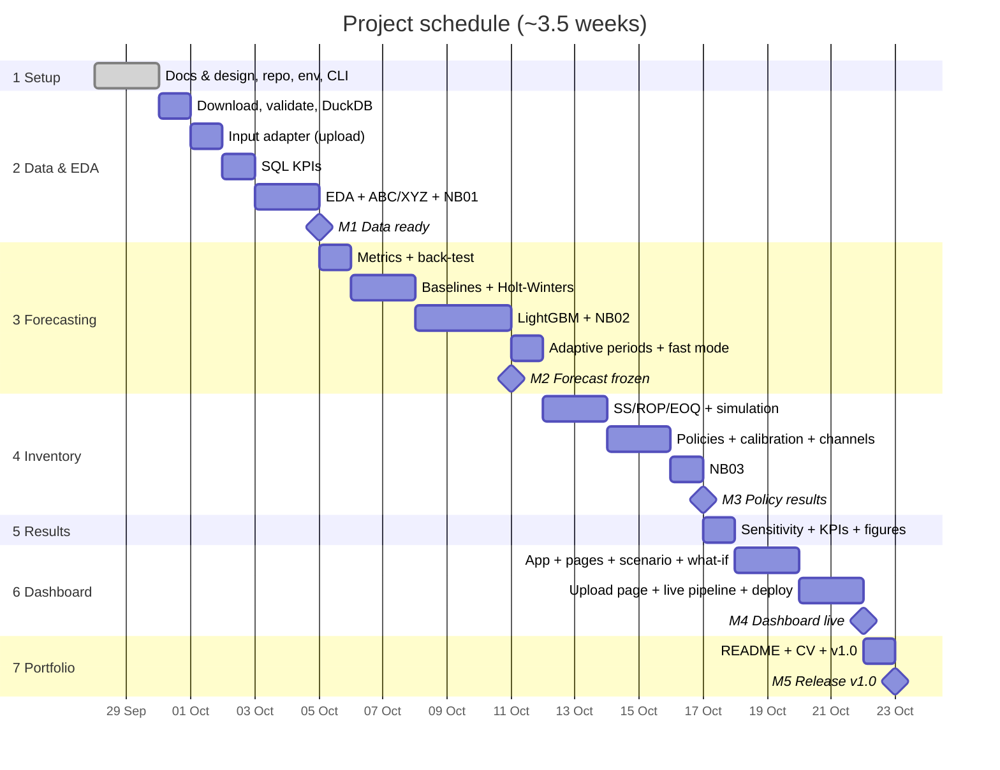

# 04 — Work Breakdown Structure & Schedule

## 1. WBS tree

```mermaid
flowchart TD
    P["0 Demand Forecasting &<br/>Inventory Optimization"]
    P --> W1["1 Project management<br/>& setup"]
    P --> W2["2 Data & exploration"]
    P --> W3["3 Demand forecasting"]
    P --> W4["4 Inventory policy<br/>& simulation"]
    P --> W5["5 KPIs & results"]
    P --> W6["6 Dashboard<br/>& deployment"]
    P --> W7["7 Documentation<br/>& portfolio"]

    W1 --> W11["1.1 Documentation & design"]
    W1 --> W12["1.2 Repo, env, CI lint/test"]
    W1 --> W13["1.3 Config & pipeline CLI"]

    W2 --> W21["2.1 Data download & validation"]
    W2 --> W22["2.2 DuckDB load + price table"]
    W2 --> W23["2.3 SQL KPI queries"]
    W2 --> W24["2.4 Trend & seasonality EDA"]
    W2 --> W25["2.5 ABC / XYZ classification"]
    W2 --> W26["2.6 Notebook 01"]
    W2 --> W27["2.7 Input adapter<br/>(mapping · standardise · validate)"]

    W3 --> W31["3.1 Metrics module"]
    W3 --> W32["3.2 Back-test framework"]
    W3 --> W33["3.3 Baselines: naive, MA"]
    W3 --> W34["3.4 Holt-Winters"]
    W3 --> W35["3.5 LightGBM + features"]
    W3 --> W36["3.6 Notebook 02"]
    W3 --> W37["3.7 Adaptive periods,<br/>features & fast mode"]

    W4 --> W41["4.1 SS / ROP / EOQ"]
    W4 --> W42["4.2 Simulation engine"]
    W4 --> W43["4.3 Policies P0 / P1 / P2"]
    W4 --> W44["4.4 Iso-service calibration"]
    W4 --> W45["4.5 Notebook 03"]
    W4 --> W46["4.6 Channel model<br/>(physical / online)"]

    W5 --> W51["5.1 Sensitivity analysis"]
    W5 --> W52["5.2 KPI aggregation"]
    W5 --> W53["5.3 Figures & artefacts"]

    W6 --> W61["6.1 App skeleton & data layer"]
    W6 --> W62["6.2 Pages"]
    W6 --> W63["6.3 What-if panel"]
    W6 --> W64["6.4 Deploy to Streamlit Cloud"]
    W6 --> W65["6.5 Power BI (optional)"]
    W6 --> W66["6.6 Scenario panel<br/>(stores · products · channel)"]
    W6 --> W67["6.7 Upload page +<br/>live pipeline"]

    W7 --> W71["7.1 Final README"]
    W7 --> W72["7.2 CV bullet & LinkedIn post"]
    W7 --> W73["7.3 Final review & release v1.0"]
```

## 2. WBS dictionary

Estimates are in hours (h). Total ≈ **73 h** (including 4.6 + 6.6 for the configurable scenario and 2.7 + 3.7 + 6.7 for user uploads). At ~20 h/week this is **~3.5 weeks**; if the 3-week deadline is fixed, 6.5 (Power BI) and the Could items are cut first.

| WBS | Work package | Deliverable | Acceptance criteria | Est. | Depends on |
|---|---|---|---|---|---|
| **1.1** | Documentation & design | `docs/*` | All docs reviewed; traceability matrix complete | 4 | — |
| **1.2** | Repo, environment, CI | Repo, `requirements.txt`, GitHub Actions (ruff + pytest) | `pip install` works in a clean venv; CI is green | 2 | 1.1 |
| **1.3** | Config & pipeline CLI | `config/params.yaml`, `src/config.py`, `src/pipeline.py` | `--help` lists all steps; config is validated on load | 2 | 1.2 |
| **2.1** | Data download & validation | `data/README.md`, `src/data.validate()` | 913,000 rows; 500 series × 1,826 days; 0 duplicates/NaN | 1.5 | 1.3 |
| **2.2** | DuckDB load + price table | `inventory.duckdb`, `item_prices` table | Tables exist; row counts match | 1.5 | 2.1 |
| **2.3** | SQL KPI queries | `sql/kpi_queries.sql` | ≥ 8 queries, each commented; results match pandas | 3 | 2.2 |
| **2.4** | Trend & seasonality EDA | Charts: trend, DOW index, month index, heatmap | Charts saved to `reports/figures/` | 3 | 2.2 |
| **2.5** | ABC / XYZ | `src/classification.py`, matrix table | Classes add up to 50 items; Pareto chart | 2 | 2.2 |
| **2.6** | Notebook 01 | `01_eda_abc_xyz.ipynb` | Runs top to bottom; has conclusions | 2 | 2.3–2.5 |
| **2.7** | Input adapter | `src/ingest.py`: read CSV/XLSX/Parquet, guess + apply column mapping, standardise, validation report; template CSV | Tests T-G1–T-G10 pass; demo goes through the same adapter | 4 | 2.1 |
| **3.1** | Metrics module | `src/metrics.py` + tests | Tests pass on hand-computed cases | 1 | 1.3 |
| **3.2** | Back-test framework | `src/forecast.backtest()` | No leakage (test proves origin < target); same folds for all models | 3 | 3.1 |
| **3.3** | Baselines | `SeasonalNaive`, `MovingAverage` | Leaderboard rows present | 1 | 3.2 |
| **3.4** | Holt-Winters | `HoltWinters` | Fits 500 series in < 5 min per origin batch | 3 | 3.2 |
| **3.5** | LightGBM + features | `LightGBMForecaster`, `src/features.py` | Beats seasonal naive on validation; feature importance chart | 5 | 3.2 |
| **3.6** | Notebook 02 | `02_forecasting.ipynb` | Leaderboard + headline "−X% WAPE" | 2 | 3.3–3.5 |
| **3.7** | Adaptive periods, features & fast mode | `src/profile.py` (history profile → periods, lags, models), fast-mode settings, vectorised batch simulation | 3 rule tests (short / medium / long history); 200 series × 3 yrs in < 60 s | 4 | 3.5, 2.7 |
| **4.1** | SS / ROP / EOQ | `src/inventory.py` + tests | Matches textbook examples | 2 | 1.3 |
| **4.2** | Simulation engine | `src/simulation.simulate()` | Invariant tests pass (stock balance, no negative stock) | 4 | 4.1 |
| **4.3** | Policies P0/P1/P2 | Policy classes | Each runs on 500 series in < 60 s | 2 | 4.2, 3.5 |
| **4.4** | Iso-service calibration | `calibrate_to_fill_rate()` | Every policy reaches 95% ± 0.2 pp | 2 | 4.3 |
| **4.5** | Notebook 03 | `03_inventory_simulation.ipynb` | Headline "−X% inventory at 95% fill rate"; section comparing physical vs. online | 2 | 4.4 |
| **4.6** | Channel model | Backorder logic in `simulate()`, channel parameters, `src/scenario.py`, simulation of both channels | Invariant tests with backorders pass; artefacts have a `channel` column | 3 | 4.2 |
| **5.1** | Sensitivity analysis | Lead time × service level grid | Chart + table | 2 | 4.4 |
| **5.2** | KPI aggregation | `src/kpi.py` | KPIs per series/class/total | 1.5 | 4.4 |
| **5.3** | Figures & artefacts | `reports/figures/*.png`, `artefacts/*.parquet`, `manifest.json` | Size < 50 MB | 1.5 | 5.2 |
| **6.1** | App skeleton & data layer | `app/streamlit_app.py`, cached loaders | Runs locally | 1.5 | 5.3 |
| **6.2** | Pages | Overview, Demand, Forecast, Inventory | All UC-01 → UC-05, UC-07 covered | 4 | 6.1 |
| **6.3** | What-if panel | Sliders + live one-series simulation | < 1 s per update | 2 | 6.2 |
| **6.4** | Deploy | Public URL | Works from an incognito window | 1 | 6.3 |
| **6.5** | Power BI *(optional)* | `.pbix` + screenshot | Needs Windows (VM/PC) | 3 | 5.3 |
| **6.6** | Scenario panel | Sidebar: stores, products, selection rule, channel per store; scenario badge | Every page follows the scenario; update in under 2 s | 2 | 6.2, 4.6 |
| **6.7** | Upload page + live pipeline | *Data* page: upload, mapping UI, validation report, run button, progress, switch demo/user data, downloads | UC-12 end-to-end with the template and 2 messy test files | 4 | 6.2, 3.7 |
| **7.1** | Final README | README with real numbers | Headline visible without scrolling; ≥ 4 charts | 2 | 5.3, 6.4 |
| **7.2** | CV bullet & post | Text snippets in `docs/` | One sentence with numbers | 0.5 | 7.1 |
| **7.3** | Final review & v1.0 | Git tag `v1.0.0` | Success criteria of the charter met | 1 | all |

## 3. Schedule (Gantt)

> The calendar includes weekends: a "day" here means a working session of about 2.5–3 h, not a full-time day (≈ 73 h over ~25 days).

## 4. Milestones

| ID | Milestone | Target date | Exit criteria |
|---|---|---|---|
| M0 | Design approved | 2026-09-28 | This documentation set is complete |
| M1 | Data ready (demo + input adapter) | 2026-10-04 | DuckDB built, SQL KPIs and NB01 done |
| M2 | Forecast frozen | 2026-10-11 | Leaderboard final; best model chosen |
| M3 | Policy results | 2026-10-17 | Headline inventory reduction computed |
| M4 | Dashboard live (demo + upload) | 2026-10-21 | Public URL works |
| M5 | Release v1.0 | 2026-10-22 | README with real numbers; tag `v1.0.0` |
