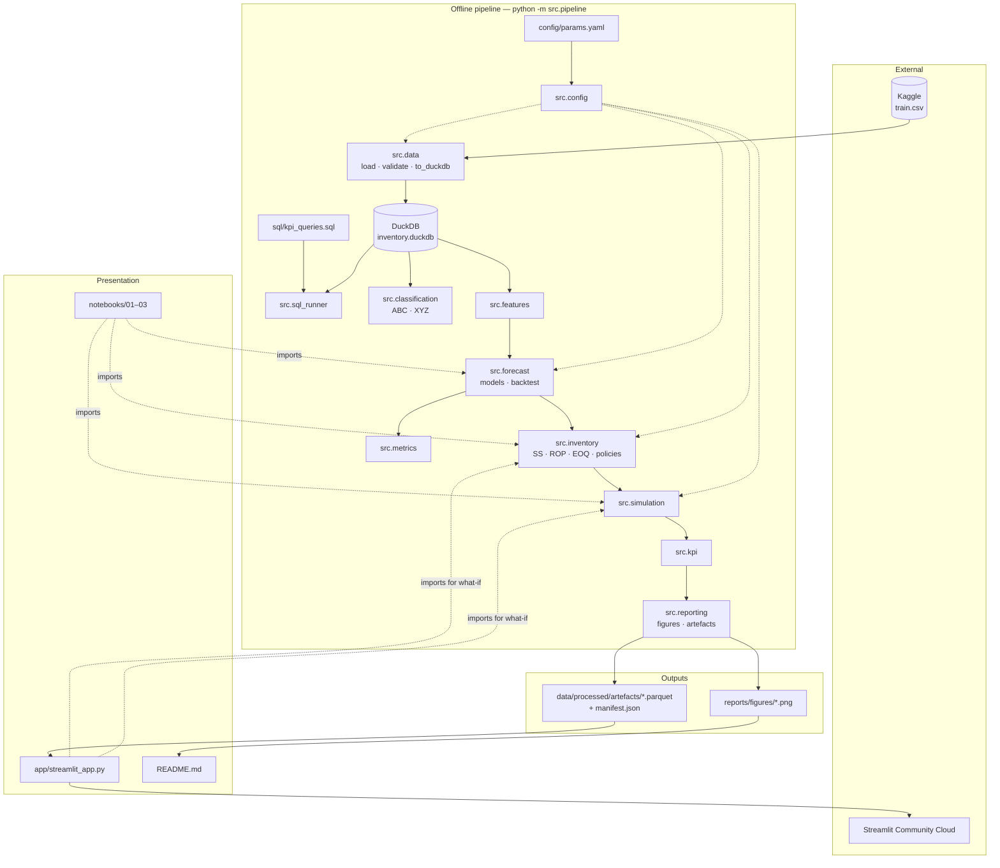
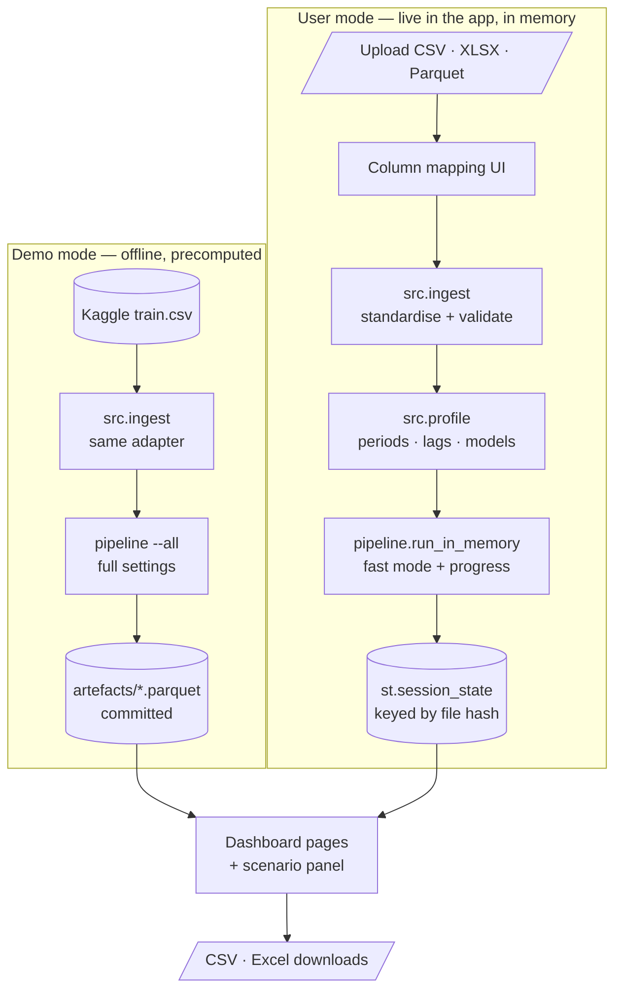
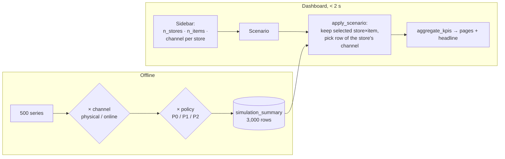

# 05 — Architecture

## 1. Design principles

1. **Business logic lives only in `src/`.** Notebooks tell the story, the app displays results; both import `src`.
2. **Offline pipeline, online display.** Heavy work (back-tests, 500 × 3 simulations) runs offline; the dashboard reads small precomputed Parquet files ([ADR-0003](adr/0003-precomputed-artefacts-for-dashboard.md)).
3. **One source of truth for assumptions:** `config/params.yaml`.
4. **SQL for descriptive KPIs, Python for models.** DuckDB queries Parquet/CSV directly and needs no server ([ADR-0001](adr/0001-duckdb-over-sqlite.md)).
5. **Reproducible:** fixed seeds, pinned versions, one CLI entry point.

## 2. Component view



## 2b. Two data modes: demo (precomputed) and user upload (live)



- **One code path:** the demo goes through the **same input adapter** as uploads (its columns are mapped `sales → quantity`), so the adapter is tested on every demo run.
- **Offline vs. live:** the demo keeps the full settings (refit every 13 weekly origins, Holt-Winters for every series). Uploads use **fast mode** (methodology §4.4): one fit per period, fewer LightGBM trees.
- **Active dataset:** a single object `ActiveData` (demo artefacts or live results) feeds every page; the scenario panel, sliders and headline read from it.
- **Privacy:** uploads are never written to disk (NFR-12).

## 3. Pipeline steps (data flow)

`run_analysis()` does every step in memory; the CLI groups them in three cacheable steps (`--step`).

| CLI step | Inside | Input | Output | Modules |
|---|---|---|---|---|
| `ingest` | read → map → standardise | `data/raw/train.csv` (demo) or `--input` + `--map` | `StandardisedData` → `work/data.joblib` | `src.ingest`, `src.data` |
| `analyse` | validate + profile | standardised data | `ValidationReport`, `DataProfile` (periods, lags, models, exclusions) | `src.ingest`, `src.profile` |
| | SQL KPIs | DuckDB (file for the demo, `:memory:` for uploads) | 13 query results | `src.data`, `src.sql_runner` |
| | ABC / XYZ | validation-period sales, prices | classification | `src.classification` |
| | back-tests | demand matrix | validation + test `BacktestResult`, error sums, best model | `src.features`, `src.forecast`, `src.metrics` |
| | policies + simulation | best-model forecast paths, validation statistics | per-series results for 2 channels × 3 policies × 2 variants, trade-off curves, sensitivity | `src.policy`, `src.inventory`, `src.simulation` |
| | KPIs + headline | simulation sums | costs, KPIs, headline for the default scenario | `src.kpi`, `src.scenario` → `work/results.joblib` |
| `report` | outputs | cached results + current config | `reports/validation.md`, `reports/figures/*.png`, `data/processed/artefacts/*` | `src.reporting`, `src.pipeline` |

Measured on a laptop (Apple M4, 10 cores), full mode, 500 series × 5 years: **about 90 s**, of which ~85 s
back-tests (Holt-Winters + LightGBM, refit every 13 weekly origins) and ~2 s for 12 calibrated simulations of
500 series × 365 days.

## 4. Folder responsibilities

| Path | Contains | Committed to git? |
|---|---|---|
| `config/` | `params.yaml` (business assumptions, model settings, paths) | ✅ |
| `data/raw/` | Kaggle CSVs | ❌ (`.gitignore`, licence) |
| `data/reference/` | `item_prices.csv` (synthetic demo prices) | ✅ |
| `data/templates/` | `sales_history_template.csv` for uploads | ✅ |
| `data/processed/` | `inventory.duckdb`, `work/` cache | ❌ |
| `data/processed/artefacts/` | Parquet + JSON results for the dashboard (≈ 4 MB) | ✅ ([ADR-0003](adr/0003-precomputed-artefacts-for-dashboard.md)) |
| `sql/` | KPI queries, one named block per query | ✅ |
| `src/` | Python package | ✅ |
| `notebooks/` | Storytelling notebooks, outputs kept | ✅ |
| `app/` | Streamlit dashboard | ✅ |
| `reports/` | `figures/*.png` for the README, `validation.md` | ✅ |
| `scripts/` | `fix_lightgbm_macos.py` (macOS without Homebrew) | ✅ |
| `tests/` | pytest (synthetic data, no download needed) | ✅ |
| `docs/` | This documentation | ✅ |

## 5. `src/` layout

```
src/
├── config.py          # params.yaml → validated frozen dataclasses
├── ingest.py          # read_any, guess_mapping, standardise, validate (input contract)
├── series.py          # DemandMatrix: dense (series × day) demand, natural ID order
├── profile.py         # adaptive periods, lags, models, exclusions
├── data.py            # demo loader, synthetic prices, DuckDB
├── sql_runner.py      # named SQL queries
├── classification.py  # ABC / XYZ
├── features.py        # leakage-safe LightGBM features
├── forecast.py        # 4 models, rolling-origin back-test, lead-time demand
├── metrics.py         # WAPE, MAPE, bias, RMSE as additive sums
├── inventory.py       # safety stock, ROP, EOQ, fill-rate factor, policy rules
├── simulation.py      # vectorised day-by-day engine + calibration
├── policy.py          # P0 / P1 / P2 parameters and runs, trade-off, sensitivity
├── kpi.py             # costs and KPIs from additive sums, headline
├── scenario.py        # stores × products × channel
├── reporting.py       # README figures (matplotlib) and artefact writers
├── synthetic.py       # Kaggle-shaped synthetic data for tests and CI
└── pipeline.py        # CLI, run_analysis(), run_in_memory()
```

## 6. Dashboard structure

```
app/
├── streamlit_app.py   # st.navigation + the scenario sidebar shared by every page
├── common.py          # ActiveData (demo artefacts or live upload), scenario sidebar, formatting
├── charts.py          # Plotly figures, light/dark palette
├── tools.py           # one-series inputs, simulation and what-if
└── views/
    ├── overview.py    # UC-07, UC-10: headline, KPI tiles, comparison tables
    ├── demand.py      # UC-01, UC-02: trend, seasonality, ABC/XYZ, SQL
    ├── forecast.py    # UC-03, UC-04: leaderboard, breakdowns, series explorer
    ├── inventory.py   # UC-05, UC-06: trade-off, parameters, trajectory, what-if, sensitivity
    └── data.py        # UC-12: demo / upload switch, mapping, validation, run, downloads
```

## 7. Scenario layer (stores · products · channel)

The user picks a scenario at runtime; the heavy results are **not** recomputed ([ADR-0005](adr/0005-configurable-scenario-and-channels.md)).



Because KPIs are stored as **sums** (demand, sales, lost, inventory-days, costs) per series, any scenario is aggregated exactly by summing rows. No averages of ratios are needed.

## 8. Technology choices

| Concern | Choice | Why |
|---|---|---|
| Storage / SQL | DuckDB | Columnar, fast on 1M rows, reads Parquet, zero setup — [ADR-0001](adr/0001-duckdb-over-sqlite.md) |
| Dataframes | pandas (+ pyarrow) | Standard; works with statsmodels/LightGBM |
| Classical TS | statsmodels `ExponentialSmoothing` | Required by the brief; well known |
| ML | LightGBM (one global model) | Fast; handles 500 series in one model — [ADR-0002](adr/0002-global-lightgbm-model.md) |
| Stats | SciPy (`norm.ppf`, loss function) | Safety factor z and the fill-rate solver |
| Charts | matplotlib (README PNGs), Plotly (app) | Static images for GitHub; interactive in the app |
| App | Streamlit | Free hosting; Python only |
| Quality | pytest, ruff, GitHub Actions | Light CI |
